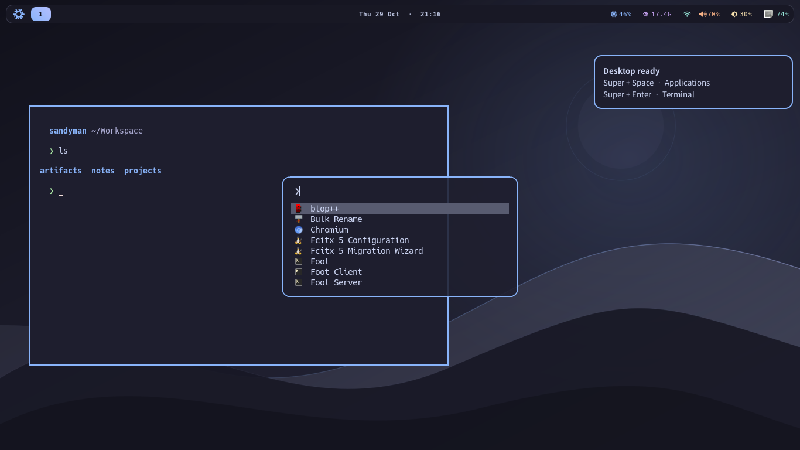

# ThinkPad X270

8GBのX270を、`sandyman` のGUIとCLIをSatelliteが使う専用PCにする設定です。
T14 Gen6の `#t14g6` とそのHome Manager設定は読み込みません。
GUIの排他制御やエージェント専用ユーザーは追加しません。Satellite本来の実行方式を使います。
モデル推論は外部APIを使い、ローカルLLMは導入しません。

## 構成と編集箇所

| ファイル | 用途 |
| --- | --- |
| `flake.nix` / `flake.lock` | 両ホストともunstable。X270のNixpkgsとHome Managerは独立した入力・revisionで固定 |
| `nixos/hosts/x270/default.nix` | 起動、ユーザー、ネットワーク、zram、電源管理 |
| `nixos/hosts/x270/hardware-configuration.nix` | 実機のディスクUUID、ドライバー |
| `nixos/hosts/x270/desktop.nix` | greetd、UWSM、Hyprland、IME、入力権限 |
| `nixos/hosts/x270/packages.nix` | OSに常備するCLIツール |
| `nixos/hosts/x270/computer-use-linux.nix` | バージョン・ハッシュ固定、NixOS向けELF修正 |
| `home/x270.nix` / `home/x270/hyprland.lua` | GUIアプリ、シェル、Git、デスクトップ設定 |
| `home/x270/appearance.nix` / `home/x270/theme/` | Catppuccin配色、Waybar、静的壁紙、GTK・アイコン・カーソル |
| `home/x270/agent.nix` / `home/x270/scripts/` | Satelliteのユーザーサービス、セットアップ・診断コマンド |
| `profiles/development/agent-packages.nix` | `#agent` のランタイム、コンパイラー、LSP等 |

インストール済みツールだけでは常駐プロセスは増えません。ブラウザ、コンパイラー、DBサーバーは自動起動しません。
PostgreSQLはクライアントコマンドを使うためにパッケージを入れるだけです。
OS側のNixビルドは1ジョブ・2コアに制限しています。

## 既存NixOSから適用する場合

画像は既にインストールされたX270の設定として取り込んでいます。再パーティションは不要です。
まずローカルで作成した変更をレビューし、Gitへcommit/pushしてX270から取得できる状態にします。
X270で次を実施します。

```sh
git clone https://github.com/SuperSandyman/dotfiles.git ~/develop/dotfiles
cd ~/develop/dotfiles

# 画像からの転記なので、適用前に実ファイルと照合する
cat /etc/nixos/hardware-configuration.nix
lsblk -f
grep system.stateVersion /etc/nixos/configuration.nix
test -d /sys/firmware/efi && echo 'UEFI boot'
```

`/` は `d7b15096-d4fb-4062-831f-db13a3d0e2d6`、`/boot` は `864D-AFF1` を指定しています。
異なれば、実機の `hardware-configuration.nix` を `nixos/hosts/x270/` へコピーして使います。
`system.stateVersion` と `home.stateVersion` の初期値は26.05です。既存システムの初回導入版が古ければ、
OSの `system.stateVersion` は元の値を維持してください。UEFI + `/boot` のEFIパーティションを前提にsystemd-bootを使います。

```sh
# 既存のパスワードは維持される。必要ならここで設定する
sudo passwd sandyman

# OSをビルド。現在のデスクトップを利用中なので、初回は次回起動用に適用
sudo nixos-rebuild boot --flake path:$PWD#x270
# 作業を保存してから再起動
sudo reboot
```

初回適用ではPlasmaからHyprlandへ切り替わるため、再起動後に確認します。
greetdが `sandyman` を自動ログインさせ、UWSM経由でHyprlandを開始します。
ログアウトした後はテキストのログイン画面に戻ります。自動再ログインを繰り返す構成ではありません。
物理アクセスできる人は自動ログインしたデスクトップを使えます。

## 新規インストールの場合

NixOSインストーラーをUEFIで起動し、対象ディスクを確認してパーティション・フォーマット・マウントを行います。
このリポジトリにはディスクを消去する自動設定はありません。
`/mnt` と `/mnt/boot` をマウントしてから、実機で次を実行します。

```sh
sudo nixos-generate-config --root /mnt
# gitがなければ nix-shell -p git
git clone https://github.com/SuperSandyman/dotfiles.git /tmp/dotfiles
sudo cp /mnt/etc/nixos/hardware-configuration.nix /tmp/dotfiles/nixos/hosts/x270/
sudo nixos-install --flake path:/tmp/dotfiles#x270
sudo nixos-enter --root /mnt -c 'passwd sandyman'
```

実機のハードウェア設定はGitにも取り込みます。初回ログイン後、リポジトリを `~/develop/dotfiles` に配置します。
暗号化やディスク構成を変えた場合は、画像から転記したUUIDではなく新しく生成した設定を使います。

## 開発環境

```sh
cd ~/develop/dotfiles
nix profile add path:$PWD/profiles/development#agent
```

既存の `#default` はT14向けです。X270で両方を追加する必要はありません。
`#agent` は独立Flakeのlockに従うため、OSとは別に更新できます。
プロジェクト固有の依存は `nix develop`、`uv`、`pnpm` 等で管理します。
一時的なツールは `nix shell nixpkgs#<package>`、常備ツールは上記のNixファイルで追加します。
`sudo npm install -g` は不要です。

## SatelliteとPi

Satelliteは非公開リポジトリを含めてユーザーのGit認証で取得できるよう、初回にホームへセットアップします。
GitHubへアクセスできるSSH鍵をX270で用意し、`ssh -T git@github.com` で確認してから実行します。
SatelliteのソースをNix storeへ埋め込まず、通常のcheckoutとして扱います。

```sh
x270-agent-setup
kaname-satellite init

# HyprlandではSatelliteのKDE向け画面制御を使わない
kaname-satellite config set sleep.display.mode none
kaname-satellite config set sleep.power.afterTasks none

# 必要なproviderを登録。APIキーはコマンドラインやGitに書かない
# 例: 対話入力で環境変数を作り、標準入力から登録する
read -rs 'provider_key?Provider API key: '; echo
printf '%s' "$provider_key" | kaname-satellite auth set anthropic --stdin
unset provider_key

systemctl --user start kaname-satellite.service
journalctl --user -u kaname-satellite.service -f
```

上のキー入力例はデフォルトシェルのzsh用です。OAuthを使うproviderは `satellite-pi` の認証機能を使います。
Kaname本体で発行する接続キーには `satellite:connect` が必要です。
双方向Control/MCPは必要な追加スコープを付けたキーをSatelliteの標準機能で登録します。
`kaname-satellite mcp` も利用できます。

セットアップはSatelliteのcommit `9150285d549c06fdec41db05fb9f71d40b633c6e` と、その `package-lock.json` を使います。
異なる版の既存checkoutを自動で書き換えません。既存checkoutの版が異なる場合は、ソースを確認して手動で更新・ビルドします。
同梱Piは **1.1.0**。`satellite-pi` はそのCLIを直接呼ぶため、別にインストールしたPiとの版ずれを避けられます。
SatelliteはグローバルExtensionの探索を無効化していないため、同じ `~/.pi/agent` のExtensionを読み込みます。
PiのSkillはSatellite側の既存の選択方式に従います。

初期Extensionは次の版を指定してPiの標準インストーラーで導入します。

- `@agent-sh/computer-use-linux@0.7.31`
- `pi-lsp@0.1.7`
- `pi-fff@0.1.13`
- `pi-web-access@0.45.0`
- `pi-redact@0.1.0`

`pi-fff` は旧 `@mariozechner/pi-*` への依存を宣言していますが、同梱Pi 1.1.0の互換エイリアスで読み込めます。
T14のNixOS上でExtension読み込みと、ネイティブ検索エンジンによるファイル検索まで確認しています。
外部Extensionは `satellite-pi install npm:<name>@<version>` で追加し、`satellite-pi list` で確認します。
Extension設定とnpm lockfileはユーザーの `~/.pi/agent` にあり、追加・削除可能です。OSのflake.lockとは別管理です。
Computer Useのnpmによるバイナリダウンロードは無効化し、同じ版のNixパッケージを
`COMPUTER_USE_LINUX_BIN` で指定します。Piとシェルの両方で同じ修正済み実行ファイルを使います。

サービスの作業ディレクトリは `~/Workspace`。プロジェクトごとにその配下へcloneして使います。
GUIの環境変数はUWSMがユーザーsystemdへ渡します。GUI停止時はSatelliteも停止し、SSHは維持されます。
単に `loginctl enable-linger` してもGUIセッションは作れません。この構成ではlingerを必要としません。
Satellite未初期化ならサービスはスキップされるので、上記の初期化後に明示的にstartします。
Satellite自体が指定する `--no-session` は維持しています。タスク実行はPiセッション履歴を保存せず、
KanameのTicket/RunとSatelliteの状態・journalで追跡します。対話利用のPi履歴は通常どおりホームに保存されます。

## GUIとブラウザの確認

```sh
x270-agent-doctor
x270-pi-check
computer-use-linux doctor | jq .readiness
hyprctl -j monitors
hyprctl -j clients
hyprctl configerrors
foot
mousepad
chromium-agent default https://example.com
microsoft-edge https://example.com
```

`Super+Enter` でFoot、`Super+Space` / `Super+R` でFuzzel、`Super+E` でThunar、`Super+B` でEdge、`Super+Q` でウィンドウを閉じます。
`Super+左ドラッグ` で移動、`Super+右ドラッグ` でサイズ変更。キーボード配列は日本語です。
初期配置はfloating、スケール1、画面はnative解像度です。`Super+矢印` でフォーカス移動、音量・輝度キーも使えます。
配色はCatppuccin Mochaをベースに青・ラベンダーをアクセントにしています。角丸と枠線、Foot・Fuzzel・Mako、
GTKのダークテーマ、Papirusアイコン、Bibataカーソルを揃えています。アニメーション・ぼかし・影は無効です。

Waybarと静的壁紙表示用のswaybgをGUIセッション中に起動します。バーは上部に固定し、
ワークスペース1〜5、時計、CPU・メモリ、ネットワーク、音量、輝度、バッテリー、トレイを表示します。
ワークスペース切り替えにはWaylandの `ext-workspace` プロトコルを使います。
バッテリーはUPowerのdisplay deviceで内蔵・外付けの合計を扱います。
CPUは5秒、メモリ・ネットワークは10秒間隔で更新し、定期的なシェルスクリプトやネットワークへの問い合わせは追加していません。
背景はSVGからビルド時に一度PNGを作成します。動画・壁紙アニメーションはありません。
取り込んだ公開テーマの出典とMITライセンスは [theme/README.md](../home/x270/theme/README.md) にあります。



画像はT14上の隔離したSway headlessセッションで、同じバー・ランチャー・通知・端末テーマを描画した確認用プレビューです。
X270実機の画面ではなく、数値はT14の状態です。Hyprlandでは角丸とグラデーションのアクティブ枠が適用されます。

既存のGUIセッションで外観を反映する場合:

```sh
cd ~/develop/dotfiles
git pull --ff-only
sudo nixos-rebuild switch --flake path:$PWD#x270
hyprctl reload
systemctl --user restart waybar.service x270-wallpaper.service
makoctl reload
```

Footの配色・余白は新しく開いたウィンドウで確認します。バー・壁紙が起動しない場合は
`journalctl --user -u waybar -u x270-wallpaper -b` で確認できます。
AT-SPI、Qtアクセシビリティ、Chromiumのアクセシビリティツリーを有効化しています。
Microsoft Edgeも導入しています。`microsoft-edge` またはFuzzelから必要なときに起動できます。
FCitx5/Mozcを導入しています。必要なら `fcitx5-configtool` でMozcを選択します。
`x270-pi-check` はSatelliteと同じPiのResourceLoaderでExtensionを読み込み、登録ツールとエラーをJSON表示します。

PiからComputer Useのツールを呼び、次を実機で確認します。

1. doctor、ウィンドウ一覧、スクリーンショット、AT-SPIツリーを取得できる。
2. Mousepadへ日本語を入力し、クリック、ドラッグ、フォーカス、移動、サイズ変更ができる。
3. Chromiumでページ・フォーム・アップロード・ダウンロードを操作できる。
4. Kaname本体から配送したTicketでも同じ操作ができ、Runへ結果が返る。
5. GUI再起動後、サービスが新しいセッション環境で動く。蓋を閉じても作業が続く。

CLI/API、DOM、AT-SPIを利用できる操作はそれらを優先し、必要な操作にComputer Useを使います。
Hyprlandの入力はportalの存在だけで動作を保証できないため、NixOS標準のydotoolサービスを併用しています。
`sandyman` はydotoolソケットを使えるグループに属します。`/dev/input` 全体への権限は追加していません。
`x270-gui-capture` はスクリーンショット、ウィンドウ・モニターJSON、doctor結果を
`~/.local/state/agent-artifacts/` の新しいディレクトリへ保存します。画面内容を含むため共有前に確認してください。

CDPを使う場合だけ、専用プロファイルで起動します。

```sh
CDP_PORT=9222 chromium-agent dev https://example.com
curl http://127.0.0.1:9222/json/version
```

通常プロファイルと自動化用プロファイルを分け、CDPはループバックに限定します。
Playwrightはプロジェクトで `pnpm add -D @playwright/test` や `uv add playwright` として管理できます。
システムChromiumを使う場合は `executablePath: '/run/current-system/sw/bin/chromium'` を明示します。
Playwrightの対応ブラウザ版との一致が必要なテストでは、プロジェクトのNix開発環境でPlaywrightとブラウザを揃えます。
一般Linux用のブラウザを `playwright install` で取得するだけでは、NixOSで動くとは限りません。
終了時はPlaywrightの `browser.close()` を呼び、手動起動したウィンドウも閉じます。

ブラウザは通常のSecret Serviceを利用できますが、自動ログインでは暗号化されたkeyringの自動解除は保証されません。
初回にkeyringを作成・解除して保存動作を確認してください。同じ `sandyman` で動くAIは、
そのユーザーのファイル、認証済みブラウザ、秘密情報にアクセスできる前提です。

## リモート管理と電源

```sh
sudo tailscale up
tailscale status
# ~/.ssh/authorized_keys に管理用公開鍵を登録してから、別PCより接続確認
ssh sandyman@<X270のTailscaleアドレス>
```

通常のSSHは公開鍵のみ許可し、ファイアウォールではtailscale0経由の22番だけ許可しています。
Satelliteは外向きのpoll方式で、受信用ポートは開けません。VNCは初期導入しません。
家庭内LANへの送信制限はこの構成には追加していません。必要になればネットワーク側または送信ルールを別途設定します。
sudoは通常のパスワード認証です。AIへの無制限NOPASSWD設定はありません。

蓋を閉じてもlogindがスリープさせず、自動アイドルスリープも設定しません。明示的な手動スリープは可能です。
DPMS操作は画面出力を無効化する操作と区別し、実機でスクリーンショット・入力が続くことを確認してから利用してください。
電源断後の完全な無人復旧は受け入れ条件にしていません。

## 更新・停止・復旧

メイン機で編集してcommit/pushし、X270でpullして適用します。

```sh
cd ~/develop/dotfiles
git pull --ff-only
sudo nixos-rebuild switch --flake path:$PWD#x270

# X270のOS依存だけ更新。T14の入力は更新しない
nix flake update nixpkgs-x270 home-manager-x270

# 開発ツールだけ更新
nix flake update --flake ./profiles/development
nix profile upgrade development
```

X270は `nixos-unstable` とHome Managerの `master` を使用します。
更新時も `system.stateVersion` と `home.stateVersion` は初回導入時の値を維持します。
T14向けの `update-all` は全入力を更新するので、ホスト単位の更新には上のコマンドを使います。

Satelliteを更新する際は、サービス停止後にソースとPiの変更点を確認して更新し、`npm ci && npm run build` を実行します。
`setup.sh` の固定commitも更新すると、次回セットアップで同じ版を使えます。
Computer Useの更新はNix側のバージョン・バイナリハッシュとPi側のExtensionバージョンを揃えます。

```sh
# Agentとその子プロセスを停止
systemctl --user stop kaname-satellite.service
# GUIログイン時の自動開始も止める
systemctl --user mask --now kaname-satellite.service
# 再開
systemctl --user unmask kaname-satellite.service
systemctl --user start kaname-satellite.service

journalctl --user -u kaname-satellite.service -b --no-pager
sudo systemctl status greetd ydotoold tailscaled sshd
free -h
zramctl
btop
```

GUIを再起動する場合、作業が終了していることを確認してSSHまたは別TTYから
`sudo systemctl restart greetd` を実行します。GUIとSatelliteは終了し、再度自動ログインします。
SSHからGUI用CLIを使う場合、そのSSHシェルにはGUI環境が自動では入らないため、
`systemctl --user show-environment` でセッション環境を確認してください。
OSの復旧は起動時の旧generation選択、または `sudo nixos-rebuild switch --rollback` を使います。

NixOSのロールバックではホームは戻りません。バックアップ対象は少なくとも次のとおりです。

- `~/Workspace`、`~/develop` の未push変更・成果物
- `~/.config/kaname-ai-satellite`（`master.key` と暗号化された認証storeの両方が必要）
- `~/.pi/agent`（認証、Extension設定・lockfile、対話セッション）
- 必要なChromiumプロファイルと `~/.local/share/keyrings`

秘密情報を含むバックアップは暗号化し、別媒体へ保存します。Gitには認証ファイルを追加しません。

## 検証の範囲

2026-10-29にunstableへ変更し、Flakeの評価、X270のOS全体のビルド、
Hyprland 0.56.2の設定検証、Microsoft EdgeのCLI起動を確認しました。
Tailscaleは `multi-user.target` で起動する設定です。T14のsystem derivationは今回の変更前と同一です。
外観変更はOS全体のビルド、HyprlandのLua、Foot・Fuzzelの設定検証に加え、
隔離したheadless WaylandセッションでGTK・バー・ランチャー・通知の描画も確認しました。

2026-10-28にT14上で、両Flakeの `check --no-build`、X270のOS全体と `#agent` のビルド、
Hyprland 0.55.4の `--verify-config`、生成されたSatelliteユーザーunitの検証が通っています。
T14の個人用追加設定はGit対象外の `local/` に分離しています。Satelliteは固定commitを別の一時ディレクトリへ展開し、
Node 24で `npm ci`・ビルド・CLI起動を確認しました。同じPi 1.1.0で5つのExtensionを読み込み、
`pi-fff` の実検索と、Pi → Nix版Computer UseのMCP doctor呼び出しも確認しました。
doctorの接続検証はGUIのない環境を指定して行っており、X270実機の画面取得・入力を確認したものではありません。

T14上でできる検証:

```sh
nix eval --raw path:.#nixosConfigurations.t14g6.config.system.build.toplevel.drvPath
nix eval --raw path:.#nixosConfigurations.x270.config.system.build.toplevel.drvPath
nix build --no-link path:.#nixosConfigurations.x270.config.system.build.toplevel
nix build --no-link path:./profiles/development#agent
```

実機でのディスク照合、UEFI起動、画面・入力・IME、アクセシビリティツリー、蓋閉じ、
Tailscale/SSH、認証とKaname本体との往復、実際のモデル実行はX270で確認します。
ビルド成功はこれらの実機検証を代替しません。

参照: [Hyprland Lua設定例（0.55.4）](https://github.com/hyprwm/Hyprland/blob/v0.55.4/example/hyprland.lua)、
[computer-use-linux](https://github.com/agent-sh/computer-use-linux/tree/v0.7.31)、
[NixOS Manual](https://nixos.org/manual/nixos/unstable/)。
